# 💬 Awesome-Internal-Business-Messaging

  

  
  
  
  
  
  

---

# 🚀 Top Internal Business Messaging Ecosystem

**Curated List of SaaS Products & Open-Source GitHub Projects**  
*Focused on Team Chat, Real-Time Collaboration, Channels, Threading, ChatOps, Voice/Video Huddles & Sovereign Federated Messaging*  
**Last updated: November 2026** 📅

> **Internal Business Messaging** powers modern workplace communication through real-time direct messaging, organized topic channels, threaded discussions, file sharing, voice/video huddles, ChatOps bot integrations, and enterprise security governance.

---

## 📑 Table of Contents
- [📊 Sector Overview & Market Dynamics](#-sector-overview--market-dynamics)
- [☁️ SaaS/Hosted Platforms](#️-saashosted-platforms)
- [🔓 Open-Source GitHub Projects](#-open-source-github-projects)
- [🛠️ Additional Open-Source Options & Protocols](#️-additional-open-source-options--protocols)
- [🤝 How to Contribute](#-how-to-contribute)
- [💖 Support & Sponsorship](#-support--sponsorship)
- [📈 Star History](#-star-history)
- [⚠️ Disclaimer](#️-disclaimer)

---

## 📊 Sector Overview & Market Dynamics

The global team collaboration and business messaging software market is projected to reach approximately **$40 to $45 billion in 2025–2026**, growing at a CAGR of ~10–14% as enterprise digital workplaces and AI-driven workflows become standard infrastructure. 

The sector is **highly concentrated and dominated by a few massive platform ecosystems (winner-take-most dynamics)** — primarily Microsoft Teams, Google Workspace, and Salesforce Slack — while simultaneously supporting a thriving, specialized second tier of sovereign, self-hosted, and Matrix-federated open-source solutions catering to privacy-sensitive enterprises, defense, and developer communities.

---

## ☁️ SaaS/Hosted Platforms

*Sorted by company scale (Revenue / Valuation) in descending order.*

| Product | Company Revenue / Valuation 🏢 | Description 📝 | Pricing (Starting Tier) 💳 | Free Tier / Trial Limits 🎁 |
| :--- | :--- | :--- | :--- | :--- |
| **[Microsoft Teams](https://microsoft.com)** | **~$3.1 Trillion Market Cap** (Microsoft FY24 revenue ~$245B) | Unified workplace communication hub combining persistent chat, video meetings, file storage, and deep Microsoft 365 collaboration. | Teams Essentials: $4.00 / user / month (billed annually) | **Free Forever Plan**: 60-minute limit on group meetings, max 100 participants per meeting, 5 GB cloud storage total, no meeting recordings/transcripts or centralized IT admin controls. |
| **[Google Chat](https://google.com)** | **~$2.1 Trillion Market Cap** (Alphabet FY24 revenue ~$350B) | Google Workspace messaging platform built for direct messages, team spaces, smart replies, and tight integration with Gmail, Docs, and Meet. | Business Starter: $7.00 / user / month (billed annually) or $8.40 / user / month (billed monthly) | **Free Forever Plan (Personal @gmail.com)**: 15 GB shared storage (Drive/Gmail/Photos), up to 8,000 members per space, no centralized Workspace Admin Console, DLP, or Vault compliance retention. **Business Free Trial**: 14 days, max 10 users. |
| **[Slack (Salesforce)](https://slack.com)** | **~$280 Billion Market Cap** (Acquired for $27.7B; Salesforce FY24 revenue ~$34.9B) | Industry-leading cloud team messaging platform featuring organized channels, huddles, workflow automation, and thousands of enterprise app integrations. | Pro: $7.25 / user / month (billed annually) or $8.75 / user / month (billed monthly) | **Free Forever Plan**: 90-day message & file history limit (data older than 1 year deleted), 10 app integrations, 1-on-1 audio/video huddles only, 5 GB total storage, no guest accounts or SAML SSO. |
| **[Cisco Webex Messaging](https://webex.com)** | **~$230 Billion Market Cap** (Cisco FY24 revenue ~$53.8B) | Enterprise-grade cloud messaging and collaboration suite with end-to-end encryption, whiteboarding, calling, and compliance governance. | Webex Starter / Meet: $14.50 / user / month (billed annually) | **Free Forever Plan**: 40-minute limit on group meetings, max 100 participants per meeting, unlimited 1-on-1 calls, unlimited persistent team messaging & whiteboards, no cloud meeting recordings. |
| **[Zoho Internal Chat (Zoho Cliq)](https://zoho.com)** | **~$1 Billion+ Annual Revenue** (Bootstrapped, estimated valuation ~$10B–$15B) | Real-time business communication platform offering channels, audio/video calls, screen sharing, custom bots, and seamless Zoho suite connectivity. | Standard: $18.00 / month flat fee (up to 25 users, billed annually); Professional: $2.00 / user / month (min 10 users, billed annually) | **Free Forever Plan**: 10,000 searchable messages organization-wide, 100 GB total shared storage, max 100 participants per channel/group chat, 1,000 active channels, 5-minute limit on audio/video recordings, no external channels or guest chat. |
| **[Rocket.Chat (Cloud)](https://rocket.chat)** | **~$100 Million+ Valuation** (Raised ~$27M total venture funding) | Customizable communications platform supporting internal team chat, federated messaging, and omnichannel customer conversations. | Commercial Cloud: $8.00 / user / month (billed annually, min 51 seats via Marketplace) or custom quote | **Free Trial**: 30-day free trial for full Enterprise/Commercial features. **Self-Hosted Starter Tier**: Free forever up to 50 registered users, 1 workspace, and 100 monthly active omnichannel contacts. |
| **[Mattermost (Cloud)](https://mattermost.com)** | **~$70 Million+ Raised** (Series B venture-backed, valuation ~$300M+) | Secure, technical collaboration platform engineered for DevOps, defense, and enterprise teams with workflow playbooks and chatops. | Professional: $10.00 / user / month (billed annually) | **Free Trial / Evaluation**: 30-day free trial of Enterprise/Professional features (or 1-hour instant cloud sandbox). **Self-Hosted Entry Tier**: Free forever up to 10,000 message history cap, 1,000 board cards, 5 playbook runs/month, and 40-minute call caps. |
| **[Flock](https://flock.com)** | **~$20 Million+ Annual Revenue** (Part of Titan / Zeta conglomerate valued at $1.5B) | Team messaging and collaboration tool combining group channels, video conferencing, built-in to-dos, polls, and reminders. | Pro: $4.50 / user / month (billed annually) | **Free Forever Plan**: 10,000 searchable message limit across team, 5 GB total shared storage, 10 public channels, 1-on-1 video calls only (20-minute limit per call), max 20 active members. |
| **[Twist (by Doist)](https://twist.com)** | **~$10 Million+ Annual Revenue** (Bootstrapped & profitable, makers of Todoist) | Async-first team communication app organized around structured threads rather than chaotic real-time chat streams. | Unlimited: $6.00 / user / month (billed annually or monthly) | **Free Forever Plan**: 1-month message & comment history access limit, max 5 app integrations, 5 GB total storage, up to 500 member and 500 guest accounts. |
| **[Chanty](https://chanty.com)** | **~$3 Million–$5 Million Annual Revenue** (Bootstrapped SaaS product) | Simple, team-oriented business chat platform featuring unlimited message history, built-in Kanban task management, and audio/video calls. | Business: $3.00 / user / month (billed annually) or $4.00 / user / month (billed monthly) | **Free Forever Plan**: Max 5 team members, 20 GB total team storage, unlimited searchable message history, 10 integrations, 1 guest user, 1-on-1 audio/video calls only (no group calls). |

---

## 🔓 Open-Source GitHub Projects

*Sorted by GitHub Star count in descending order. Each star badge links directly to that repository's stargazers page.*

1. **[Rocket.Chat](https://github.com/RocketChat/Rocket.Chat)**  🌟  
   Feature-rich open-source team communication platform supporting real-time chat, audio/video conferencing, Matrix federation, and extensive marketplace apps.

2. **[Mattermost](https://github.com/mattermost/mattermost)**  🌟  
   Flagship open-source workplace messaging platform built in Go and React, offering Slack-compatible webhooks, incident playbooks, and enterprise security.

3. **[ntfy](https://github.com/binwiederhier/ntfy)**  🔔  
   Ultra-fast, lightweight HTTP-based pub-sub notification service for sending push alerts to phone and desktop from scripts, cron jobs, and internal DevOps bots.

4. **[Jitsi Meet](https://github.com/jitsi/jitsi-meet)**  📹  
   Open-source video conferencing and team huddle solution featuring persistent room links, text chat, screen sharing, and Slack/Mattermost integrations.

5. **[Zulip](https://github.com/zulip/zulip)**  🧵  
   Unique open-source team chat software combining the immediacy of real-time messaging with an email-like topic-based threading model for high-signal focus.

6. **[LiveKit](https://github.com/livekit/livekit)**  🎙️  
   End-to-end WebRTC realtime stack powering high-fidelity drop-in voice rooms, persistent audio huddles, video conferencing, and multimodal voice AI agents.

7. **[Hubot](https://github.com/hubotio/hubot)**  🤖  
   Customizable open-source ChatOps bot framework created by GitHub to automate deployments, alerts, and workflows inside internal team chat.

8. **[Gotify](https://github.com/gotify/server)**  🚀  
   Simple, self-hosted WebSocket-based push notification server for dispatching real-time corporate messages and automated server triggers.

9. **[Element Web](https://github.com/element-hq/element-web)**  🛡️  
   Leading open-source, end-to-end encrypted team collaboration client built on the decentralized Matrix protocol with VoIP, threads, and bridges.

10. **[Tinode](https://github.com/tinode/chat)**  📱  
    Modern, mobile-first open-source instant messaging server and SDKs built in Go with low bandwidth overhead and group chat support.

11. **[Matrix Synapse](https://github.com/matrix-org/synapse)**  🌐  
    Reference open-source Matrix homeserver enabling organizations to host federated, end-to-end encrypted internal messaging infrastructure.

12. **[Mumble](https://github.com/mumble-voip/mumble)**  🎧  
    Low-latency, high-quality open-source voice chat and text messaging software ideal for persistent engineering war rooms and drop-in audio huddles.

13. **[Matterbridge](https://github.com/42wim/matterbridge)**  🌉  
    Simple open-source bridge connecting channels across Mattermost, Rocket.Chat, Zulip, Matrix, Slack, Microsoft Teams, XMPP, and IRC.

14. **[ejabberd](https://github.com/processone/ejabberd)**  ⚡  
    Battle-tested, massively scalable open-source XMPP server and MQTT broker written in Erlang for mission-critical enterprise chat.

15. **[The Lounge](https://github.com/thelounge/thelounge)**  💬  
    Modern, responsive, cross-platform self-hosted web IRC client designed for distraction-free team communications and developer chat rooms.

16. **[Campfire (ONCE by 37signals)](https://github.com/basecamp/once-campfire)**  🏕️  
    Clean, self-hosted real-time group chat and direct messaging web application designed for simplicity, no recurring subscriptions, and zero-maintenance team rooms.

17. **[Revolt](https://github.com/revoltchat/backend)**  ⚡  
    Open-source, user-first chat platform (Discord/Slack alternative) supporting organized servers, channels, roles, and voice chat.

18. **[Ergo IRC](https://github.com/ergochat/ergo)**  🛠️  
    Modern, full-featured IRC server written in Go with integrated bouncer capabilities, history indexing, and multi-client channel synchronization.

19. **[Errbot](https://github.com/errbotio/errbot)**  🐍  
    Extensible Python chatbot framework connecting Mattermost, Rocket.Chat, Slack, Matrix, and XMPP for internal DevOps automation.

20. **[Converse.js](https://github.com/conversejs/converse.js)**  💻  
    Modular, web-based XMPP chat client written in JavaScript that can be embedded directly into corporate intranets and internal enterprise applications.

21. **[MiroTalk SFU](https://github.com/miroslavpejic85/mirotalksfu)**  🎥  
    Self-hosted, scalable WebRTC Selective Forwarding Unit (SFU) video conferencing service powered by Mediasoup for instant team video huddles.

22. **[Openfire](https://github.com/igniterealtime/Openfire)**  🔥  
    Cross-platform open-source real-time collaboration (RTC) server using the XMPP protocol with LDAP/Active Directory integration and web admin console.

23. **[Wire Server](https://github.com/wireapp/wire-server)**  🔒  
    Enterprise-grade open-source collaboration suite offering end-to-end encrypted messaging, voice/video calls, and file sharing for regulated industries.

24. **[Nextcloud Talk](https://github.com/nextcloud/spreed)**  ☁️  
    Self-hosted open-source audio/video conferencing and team chat module integrated directly with Nextcloud files, calendars, and groupware.

25. **[Conduit](https://github.com/timokoesters/conduit)**  ⚡  
    Lightweight, high-performance Matrix homeserver written in Rust designed for fast, low-resource self-hosted team messaging.

---

## 🛠️ Additional Open-Source Options & Protocols

- **[Matrix Application Service Bridges](https://github.com)** (`mautrix-slack`, `mautrix-whatsapp`, `mautrix-signal`) for unifying external messaging networks into a single internal Matrix workspace.
- **[LDAP / OIDC / SAML Auth Connectors](https://github.com)** for integrating self-hosted team chat servers with corporate Active Directory and SSO identity providers.
- **Production Stacks**: Deploy **Mattermost**, **Zulip**, or **Matrix Synapse + Element** with **LiveKit / Jitsi Meet**, **Matterbridge**, and **Hubot / Errbot** alongside **Keycloak** for an end-to-end encrypted internal business messaging sovereign stack.

---

## 🤝 How to Contribute

1. 🍴 Fork the repo.
2. ✍️ Add or update entries in `README.md` (ensure pricing, limits, star badges, and links follow existing format).
3. 🔗 Include: name, link, concise factual description, and categorization.
4. 🚀 Submit a PR with a short explanation.

---

## 💖 Support & Sponsorship

If this curated guide helps your team discover, evaluate, or architect the right internal messaging system, please consider supporting the project! ⭐

- 🌟 **Star this repository** to help others find it on GitHub.
- 🍴 **Fork and contribute** new tools or updated pricing/limits.
- ☕ **Sponsor & Buy a Coffee**: Support ongoing maintenance through the [GitHub Sponsor Dashboard](https://github.com/sponsors/ishandutta2007).

---

## 📈 Star History

---

## ⚠️ Disclaimer

- This is a **community-curated** list — not exhaustive and not an official commercial endorsement.
- Internal business messaging platforms handling corporate communications must comply with data retention, e-discovery, and privacy regulations (GDPR, HIPAA, SOC 2, ISO 27001).
- Self-hosted open-source chat platforms require proper TLS encryption, SSO/MFA enforcement, regular database backups, and file-upload antivirus scanning.

---

  <b>Built with ❤️ for IT administrators, engineering leads, security architects, and workplace collaboration builders.</b> 
  Let's make internal workplace messaging faster, more secure, and sovereign.

